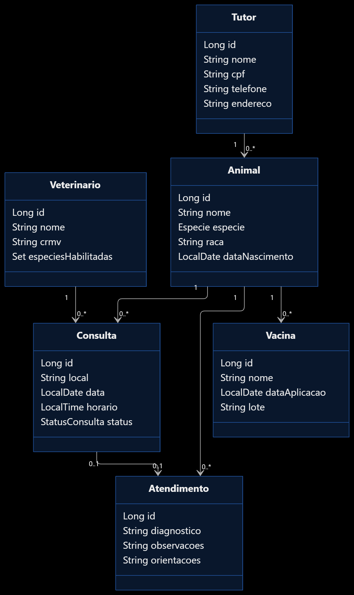

# PetCare – Sistema de Gerenciamento Veterinário

## Aluno
Giovanni Pereira Valente  
RA 240288

## 1. Sobre o projeto

O PetCare é uma API REST desenvolvida em Java 21 com Spring Boot para auxiliar no gerenciamento de uma clínica veterinária.

O sistema permite cadastrar tutores e seus animais, veterinários, agendar consultas, registrar atendimentos e controlar o histórico de vacinação dos animais.

## 2. Tecnologias utilizadas

- **Java 21** – linguagem de programação.
- **Spring Boot 3.5.x** – estrutura principal da aplicação.
- **Spring Web** – criação dos endpoints REST.
- **Spring Data JPA** – persistência e comunicação com o banco de dados.
- **H2 Database** – banco de dados relacional.
- **Jakarta Validation** – validação dos dados recebidos pela API.
- **Maven** – gerenciamento de dependências e execução do projeto.
- **Thunder Client** – ferramenta utilizada para testar os endpoints.

## 3. Funcionalidades

### Cadastro de tutores
- Cadastrar tutores.
- Consultar todos os tutores.
- Buscar tutor por ID.
- Atualizar dados de um tutor.
- Excluir tutores.
- Validar CPF e impedir cadastros duplicados.

### Cadastro de animais
- Cadastrar animais vinculados a tutores.
- Consultar animais cadastrados.
- Buscar animal por ID.
- Consultar animais de um tutor.
- Atualizar e excluir animais.

### Cadastro de veterinários
- Cadastrar veterinários.
- Informar o CRMV.
- Definir as espécies que cada veterinário está habilitado a atender.
- Consultar, atualizar e excluir veterinários.
- Impedir o cadastro de CRMV duplicado.

### Gerenciamento de consultas
- Agendar consultas.
- Consultar consultas cadastradas.
- Consultar consultas de um animal.
- Cancelar consultas.
- Impedir agendamentos no mesmo horário para um veterinário.
- Validar se o veterinário atende a espécie do animal.

### Atendimentos e prontuários
- Registrar diagnóstico.
- Registrar observações.
- Registrar orientações.
- Consultar o histórico de atendimentos de um animal.
- Consultar e imprimir registros de atendimento.

### Vacinação
- Registrar vacinas aplicadas.
- Informar nome da vacina, data de aplicação e lote.
- Consultar o histórico de vacinação de um animal.
- Impedir o registro de aplicação com data futura.

## 4. Estrutura do projeto

A aplicação está organizada em camadas para separar as responsabilidades:

```text
src
└── main
    ├── java
    │   └── com
    │       └── example
    │           └── ac2
    │               ├── Ac2Application.java
    │               ├── model
    │               ├── repository
    │               ├── dto
    │               ├── exception
    │               ├── service
    │               │   ├── interfaces
    │               │   └── impl
    │               └── controller
    └── resources
        └── application.properties
```

# Diagrama UML



---
### Responsabilidade de cada camada

- **model:** contém as entidades que representam as tabelas do banco de dados.
- **repository:** realiza operações de persistência e consultas ao banco.
- **dto:** define os dados recebidos e enviados pela API.
- **exception:** contém as exceções personalizadas e o tratamento global de erros.
- **service:** contém as regras de negócio da aplicação.
- **controller:** disponibiliza os endpoints HTTP para comunicação com o sistema.

## 5. Pré-requisitos

Antes de executar o projeto, é necessário ter instalado:

- JDK 21.
- Maven (ou Maven Wrapper disponibilizado no projeto).
- IntelliJ IDEA, Eclipse ou outra IDE compatível com Java.
- Thunder Client ou Postman para testar a API.

## 6. Configuração do banco de dados

O projeto utiliza o banco H2, que não exige instalação de um servidor de banco de dados separado.

No arquivo `src/main/resources/application.properties`, estão configuradas as propriedades:

```properties
spring.application.name=ac2

spring.datasource.url=jdbc:h2:file:./data/ac2db
spring.datasource.driver-class-name=org.h2.Driver
spring.datasource.username=sa
spring.datasource.password=

spring.jpa.database-platform=org.hibernate.dialect.H2Dialect
spring.jpa.hibernate.ddl-auto=update
spring.jpa.show-sql=true
spring.jpa.properties.hibernate.format_sql=true

spring.h2.console.enabled=true
spring.h2.console.path=/h2-console

server.port=8080
```

O banco é armazenado em arquivo, permitindo que os dados permaneçam salvos após encerrar a aplicação.

## 7. Como executar o projeto

### Passo 1 – Obter o projeto

Abra o terminal e acesse a pasta do projeto.

Caso esteja utilizando Git, clone o repositório:

```bash
git clone URL_DO_REPOSITORIO
```

Se o projeto já estiver no computador, basta abri-lo pela IDE.

### Passo 2 – Verificar o Java

No terminal, execute:

```bash
java -version
```

Confirme que a versão instalada é a 21.

### Passo 3 – Atualizar as dependências

Na pasta raiz do projeto, execute:

```bash
mvn clean install
```

Caso esteja utilizando o Maven Wrapper no Windows:

```bash
mvnw.cmd clean install
```

### Passo 4 – Executar a aplicação

Pelo terminal:

```bash
mvn spring-boot:run
```

Ou, utilizando o Maven Wrapper no Windows:

```bash
mvnw.cmd spring-boot:run
```

Também é possível abrir a classe `Ac2Application.java` na IDE e executar o método `main`.

Quando a aplicação iniciar corretamente, a API estará disponível em:

```text
http://localhost:8080
```

## 8. Acesso ao banco H2

Com a aplicação em execução, acesse:

```text
http://localhost:8080/h2-console
```

Utilize as seguintes configurações:

| Campo | Valor |
|---|---|
| Driver Class | `org.h2.Driver` |
| JDBC URL | `jdbc:h2:file:./data/ac2db` |
| User Name | `sa` |
| Password | Deixar vazio |

Clique em **Connect** para acessar o banco de dados.

## 9. Endpoints da API

Todos os endpoints utilizam a URL base:

```text
http://localhost:8080
```

### Tutores

| Método | Endpoint | Descrição |
|---|---|---|
| POST | `/tutores` | Cadastrar tutor |
| GET | `/tutores` | Listar tutores |
| GET | `/tutores/{id}` | Buscar tutor |
| PUT | `/tutores/{id}` | Atualizar tutor |
| DELETE | `/tutores/{id}` | Excluir tutor |

### Animais

| Método | Endpoint | Descrição |
|---|---|---|
| POST | `/animais` | Cadastrar animal |
| GET | `/animais` | Listar animais |
| GET | `/animais/{id}` | Buscar animal |
| GET | `/animais/tutor/{tutorId}` | Listar animais de um tutor |
| PUT | `/animais/{id}` | Atualizar animal |
| DELETE | `/animais/{id}` | Excluir animal |

### Veterinários

| Método | Endpoint | Descrição |
|---|---|---|
| POST | `/veterinarios` | Cadastrar veterinário |
| GET | `/veterinarios` | Listar veterinários |
| GET | `/veterinarios/{id}` | Buscar veterinário |
| PUT | `/veterinarios/{id}` | Atualizar veterinário |
| DELETE | `/veterinarios/{id}` | Excluir veterinário |

### Consultas

| Método | Endpoint | Descrição |
|---|---|---|
| POST | `/consultas` | Agendar consulta |
| GET | `/consultas` | Listar consultas |
| GET | `/consultas/{id}` | Buscar consulta |
| GET | `/consultas/animal/{animalId}` | Consultas de um animal |
| PUT | `/consultas/{id}/cancelar` | Cancelar consulta |

### Atendimentos

| Método | Endpoint | Descrição |
|---|---|---|
| POST | `/atendimentos` | Registrar atendimento |
| GET | `/atendimentos/{id}` | Buscar atendimento |
| GET | `/atendimentos/animal/{animalId}` | Histórico do animal |
| GET | `/atendimentos/{id}/imprimir` | Gerar página para impressão |

### Vacinas

| Método | Endpoint | Descrição |
|---|---|---|
| POST | `/vacinas` | Registrar vacina |
| GET | `/vacinas/{id}` | Buscar vacina |
| GET | `/vacinas/animal/{animalId}` | Histórico de vacinação |

## 10. Exemplos de requisições

As requisições podem ser realizadas pelo Thunder Client ou Postman.

### Cadastrar tutor

**POST** `/tutores`

```json
{
  "nome": "Maria Silva",
  "cpf": "12345678901",
  "telefone": "11999998888",
  "endereco": "Rua das Flores, 100"
}
```

### Cadastrar animal

**POST** `/animais`

```json
{
  "nome": "Rex",
  "especie": "CACHORRO",
  "raca": "Labrador",
  "dataNascimento": "2021-05-10",
  "tutorId": 1
}
```

### Cadastrar veterinário

**POST** `/veterinarios`

```json
{
  "nome": "Carlos Souza",
  "crmv": "SP12345",
  "especiesHabilitadas": [
    "CACHORRO",
    "GATO"
  ]
}
```

### Agendar consulta

**POST** `/consultas`

```json
{
  "animalId": 1,
  "veterinarioId": 1,
  "local": "Sala 2",
  "data": "2026-11-10",
  "horario": "14:00:00"
}
```

### Registrar atendimento

**POST** `/atendimentos`

```json
{
  "animalId": 1,
  "consultaId": 1,
  "diagnostico": "Animal saudável.",
  "observacoes": "Sem alterações clínicas.",
  "orientacoes": "Manter vacinação em dia."
}
```

### Registrar vacina

**POST** `/vacinas`

```json
{
  "animalId": 1,
  "nome": "Antirrábica",
  "dataAplicacao": "2026-11-04",
  "lote": "VAC2026001"
}
```

## 11. Tratamento de erros

O projeto possui exceções personalizadas e tratamento global de erros.

- **404 – Not Found:** recurso não encontrado.
- **400 – Bad Request:** dados inválidos ou regra de negócio não atendida.
- **409 – Conflict:** conflito com dados existentes ou integridade referencial.

Exemplos de validações:
- CPF duplicado.
- CRMV duplicado.
- Veterinário não habilitado para atender determinada espécie.
- Veterinário já ocupado no mesmo dia e horário.
- Tentativa de cancelar consulta já realizada.
- Registro de vacina com data futura.

## 12. Testes da API

Os testes podem ser realizados utilizando o Thunder Client.

Recomenda-se seguir esta ordem:

1. Cadastrar um tutor.
2. Cadastrar um animal utilizando o ID do tutor.
3. Cadastrar um veterinário.
4. Agendar uma consulta utilizando os IDs do animal e do veterinário.
5. Registrar o atendimento.
6. Registrar uma vacina.
7. Consultar o histórico de atendimentos e vacinação.
8. Testar as validações e os tratamentos de erro.

**Importante:** os IDs utilizados nas requisições devem corresponder aos registros realmente cadastrados no banco.

## 13. Considerações finais

O PetCare foi desenvolvido com uma arquitetura em camadas, utilizando Spring Boot e Spring Data JPA para organizar as operações e regras de negócio de uma clínica veterinária.

A aplicação permite gerenciar tutores, animais, veterinários, consultas, atendimentos e vacinas, além de realizar validações para manter a consistência das informações.

O projeto pode ser expandido futuramente com autenticação de usuários, controle de permissões, integração com banco de dados PostgreSQL e geração de relatórios.